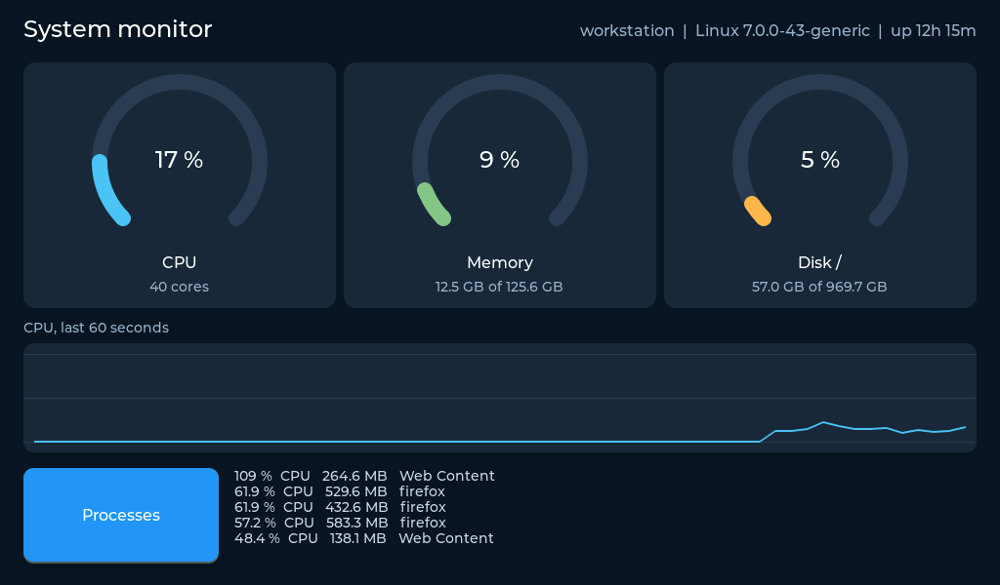

# MicroPython on the PC: files, commands and the network

MicroPython was made for boards, but on the PC LVGL MPY Studio runs it as the **unix port**, a
real program of the operating system. An application or a program without pages can therefore
do on the PC what it cannot do on a board: run commands, read and write any file, open network
connections, start threads, call the C functions of a system library.

That makes the simulator and the executables more than a preview: a kiosk on a Linux PC, a
test bench that drives instruments from an LVGL panel, a dashboard that reads a log, or the PC
side of a board project, written in the same MicroPython.

The example [`examples/sysmon`](https://github.com/Copper-And-Code/lvgl-mpy-studio/tree/main/examples/sysmon)
is such a dashboard: CPU, memory and disk read from `/proc`, a chart, and the busiest processes
from `ps` run through `os.system`. On a board the same project shows what MicroPython knows there.



## Where it works

| | Commands (`os.system`) | Files | `ffi` | `socket` | `ssl` | `_thread` | `termios` |
|---|---|---|---|---|---|---|---|
| Simulator on Linux, and the folder executable for Linux | yes | yes | yes | yes | yes | yes | yes |
| Single-file executable for Linux | yes | yes | no | yes | no | yes | yes |
| Windows: simulator | yes | yes | no | no | no | no | no |
| In the browser | no | in the page's memory | no | no | no | no | no |
| On a board | no | the flash and the SD | no | depends on the board | depends on the board | depends on the board | no |

On every PC version `os` also has `getenv`, `putenv`, `unsetenv`, `listdir`, `ilistdir`,
`mkdir`, `rmdir`, `remove`, `rename`, `stat`, `statvfs`, `chdir` and `getcwd`, and `json`, `re`,
`hashlib` and `machine` are available. There is no `subprocess` module.

The single-file executable for Linux is linked statically and leaves out `ffi` and `ssl`. The
folder executable and the single-file executable for Windows are built from the same Windows
port as the simulator, but their modules have not been listed one by one.

## Examples

All of these ran on the Linux runtime of the IDE, MicroPython 1.29.0.

**A command and its output.** `os.system` returns the exit code. To read what the command
printed, send it to a file:

```python
import os

def run(command):
    out = "/tmp/lms_cmd.txt"
    code = os.system(command + " > " + out + " 2>&1")
    with open(out) as f:
        text = f.read()
    os.remove(out)
    return code, text

code, text = run("uname -sr")
```

**The output without a temporary file**, through `ffi` and the C function `popen` (Linux, not in
the single-file executable):

```python
import ffi

libc = ffi.open("libc.so.6")
popen = libc.func("p", "popen", "ss")
pclose = libc.func("i", "pclose", "p")
fread = libc.func("i", "fread", "piip")

def capture(command):
    stream = popen(command, "r")
    buf = bytearray(4096)
    chunks = []
    while True:
        n = fread(buf, 1, len(buf), stream)
        if n <= 0:
            break
        chunks.append(bytes(buf[:n]))
    return pclose(stream), b"".join(chunks).decode()
```

`ffi` reaches any function of any shared library in the same way: `fork`, `kill`, `ioctl`, or
the API of a library of your own.

**Files**, anywhere the user can write:

```python
import os

with open("/home/me/readings.csv", "a") as f:
    f.write("22.5\n")
print(os.listdir("/home/me"), os.stat("/home/me/readings.csv")[6])   # size in bytes
```

**A thread and a socket**, as in CPython, with the names of MicroPython:

```python
import _thread, socket

def serve():
    server = socket.socket()
    server.setsockopt(socket.SOL_SOCKET, socket.SO_REUSEADDR, 1)
    server.bind(socket.getaddrinfo("0.0.0.0", 8080)[0][-1])
    server.listen(1)
    while True:
        client, _ = server.accept()
        client.send(b"HTTP/1.0 200 OK\r\n\r\nhello from LVGL MPY Studio\r\n")
        client.close()

_thread.start_new_thread(serve, ())
```

The threads of the unix port run without a global lock (`sys.implementation._thread` is
`"unsafe"`): keep LVGL calls in the main thread and pass data to it, for example through a list
read by an `lv.timer`.

## One program for the PC and for the board

`sys.platform` tells where the program runs: `"linux"` or `"win32"` on the PC, `"esp32"`,
`"rp2"` or `"pyboard"` (the STM32 port) on a board. Keep the parts that need the operating system behind it:

```python
import sys

ON_PC = sys.platform in ("linux", "win32")

def temperature():
    if ON_PC:
        return 22.5            # or read a file, a socket, a command
    from machine import ADC
    return ADC(0).read_u16() * 0.01
```

## Programs without pages

**Run → Run Program…** gives a program without pages the folder of its flash as `/`, as a board
does: `open()`, `os.listdir()` and the other paths of `os` stay inside it, so `/tmp` is a folder
of the flash, not the system's. This imitates a board; it is not a barrier: `os.system` and
`ffi` still reach the whole system. Programs with pages, and the executables, see the real
filesystem.

## Safety

An application run in the simulator or as an executable has the permissions of the user who
starts it, like any Python script: it can delete files, read keys, open connections. **Run only
projects and programs you trust**, as with code downloaded from anywhere. The IDE does not
restrict them.

## What has been verified

On 14 November 2026 the examples of this page ran on the Linux runtime of the IDE, and the table
was read from the runtimes themselves: the Linux runtime and the single-file one for Linux
natively, the Windows runtime under Wine, which lists its modules as Windows would. `os.system`
ran on all three. Nothing of this page has been tried on a real Windows.
