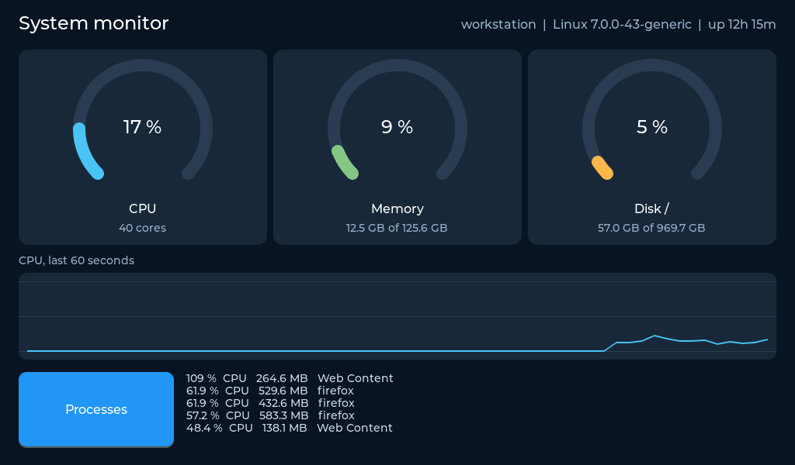

# System Monitor

An LVGL dashboard of the computer it runs on: CPU, memory and disk as gauges, the CPU of the
last 60 seconds as a chart, and the busiest processes on request. It shows that on a PC the
MicroPython of Copper and Code Studio is a program of the operating system
([Files, commands and the network on the PC](../../docs/pc-programs.md)).

- `sysinfo.py` reads `/proc/stat`, `/proc/meminfo`, `/proc/uptime` and `/etc/os-release`, and
  `os.statvfs("/")` for the disk.
- **Processes** runs `ps` through `os.system` and shows its five busiest lines.
- The same project runs on a board, the STM32H7_CORE V1.3 at 1024×600 of its profile: there
  `sys.platform` is not `"linux"`, so the CPU shows `n/a`, the memory is MicroPython's heap,
  the disk is the flash, and **Processes** says that it needs the PC.
- In the [demo gallery](https://copper-and-code.github.io/lvgl-mpy-studio/demos/) it runs in the
  browser, which has no operating system either: MicroPython's heap, and `n/a` for CPU and disk.

Open `project.json` in the IDE and press F5, on Linux. It was built by an AI agent through the
MCP server and checked in the simulator, on Linux and with the board's path forced from a
scenario, and in the browser in Chromium; it has not been run on a board or on Windows yet.

## A prompt for an agent

The example was made by an agent in a conversation with the author, not from a single prompt.
This is a prompt that asks for the same result through the [MCP server](../../docs/mcp.md):

> Build a system monitor for the STM32H7_CORE V1.3 (1024×600) as an LVGL MPY Studio project in
> `examples/sysmon`. On a Linux PC it shows three gauges, CPU, memory and disk, read from
> `/proc/stat`, `/proc/meminfo` and `os.statvfs("/")`; the distribution, kernel and uptime at the
> top; a chart of the CPU over the last 60 seconds, refreshed every second; and a Processes
> button that runs `ps` through `os.system` and lists the five busiest processes. Put the reading
> of the system in a module of its own. The same project must run on a board: where
> `sys.platform` is not `"linux"`, show the CPU as not available, MicroPython's heap as the
> memory, the flash as the disk, and say that Processes needs the PC. Use only the font sizes of
> the board. Check it with simulate on Linux, and once more with the board's path forced from a
> scenario, before you finish.
